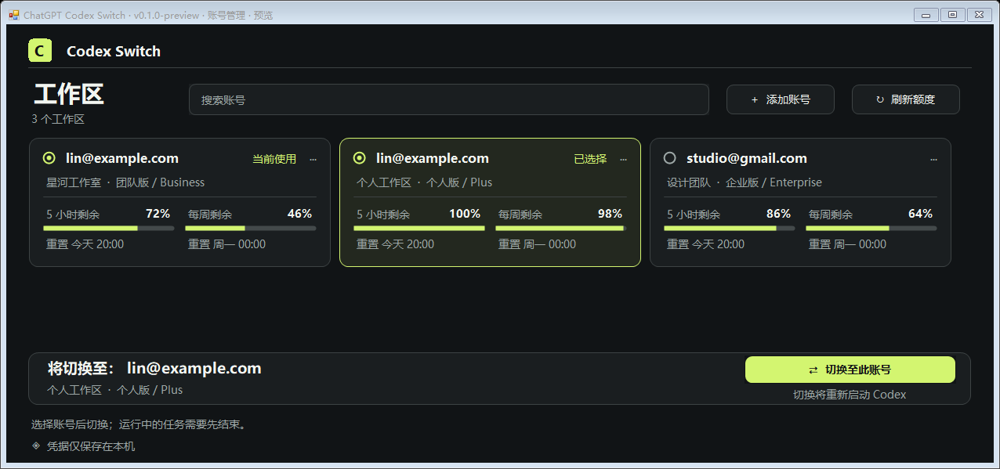

# ChatGPT Codex Switch

**A portable Windows account switcher and quota viewer for Codex Desktop.**

[中文说明](README.md) · [Download](https://github.com/Gerson369/chatgpt-codex-switch/releases) · [Changelog](CHANGELOG.md)

**v0.1.0 preview.** Independent community project, not affiliated with or supported by OpenAI. This manages ChatGPT sign-ins used by Codex Desktop. It does not manage ChatGPT web chat history.

## Features

- Save multiple authorized ChatGPT logins and distinguish personal, Business and Enterprise workspaces, including separate workspaces under one email.
- Add accounts through the official Codex browser or device-code login flow.
- Read the quota windows actually returned by Codex app-server, with remaining percentages and local reset times. Missing data is not displayed as a zero balance.
- Browse responsive three-, two- or one-column cards, search emails/notes/plans, use keyboard navigation and edit notes through the card menu.
- Manually switch the active login and restart Codex, keeping the original local chat, project and configuration files.
- Confirm a successful switch or restore the previous login if needed. A pending switch must be resolved before switching again.
- Encrypt saved credentials using Windows DPAPI for the current Windows user.

## Install and use

1. Download `chatgpt-codex-switch-v0.1.0-windows-x64.zip` from [Releases](https://github.com/Gerson369/chatgpt-codex-switch/releases).
2. Extract and run `ChatGPTCodexSwitch.exe`. No installer, administrator access or third-party runtime download is required.
3. The current valid file-based Codex login is saved automatically. Existing profiles from earlier builds remain available.
4. Add another account, select its card, save active work, and choose the switch action.
5. Verify the active account inside Codex, then confirm the switch in this tool. Restore the previous login if something went wrong.

**Switching restarts Codex and interrupts running tasks.** The tool ends identified Codex desktop processes and CLI/background processes in the corresponding installation directory. Browsers are excluded. It does not hot-switch, automatically rotate accounts or resume tasks after a switch.

## Requirements and limits

Windows 10/11 x64 with .NET Framework 4.8 recommended, and the Microsoft Store `OpenAI.Codex` desktop package. The integrated desktop application may appear as ChatGPT. Only ChatGPT file-based `auth.json` authentication is supported; API keys and keyring/ephemeral authentication are not supported. No macOS or Linux build is provided.

Quota reads use the documented experimental app-server external-token interface. They pass only the short-lived access token, not a refresh token. Expired access tokens may require adding the account again. Available quota windows vary by plan and service response. Future Codex releases may require compatibility updates.

Local files remain in the original `CODEX_HOME` or `%USERPROFILE%\.codex`. Cloud data, workspace permissions and account-specific sidebar visibility remain controlled by Codex. Encrypted profiles live in `%LOCALAPPDATA%\CodexLocalSwitcher\accounts` and are tied to the current Windows user. Temporary login files may remain after a crash. Never share authentication files or profile backups.

The executable is unsigned. Releases include SHA-256 checksums. Do not bypass system security blocks; verify the source or build it yourself.

## Build and verification

Run `build.cmd` on Windows. It uses the built-in .NET Framework compiler, with no NuGet/npm dependencies. The executable is written to `dist\ChatGPTCodexSwitch.exe`.

The build runs 34 synthetic checks and UI checks covering UTF-8 parsing under a Chinese Windows code page, 43-account search/scrolling, responsive columns, keyboard navigation, selection protection and dialogs. Tests do not use real credentials, log in or close Codex. Read-only quota retrieval was additionally verified with two Business profiles and one Plus profile. Not every Codex version, DPI setting or organization policy has been tested.

[MIT license](LICENSE) · [Security](SECURITY.md) · [Official Codex authentication docs](https://learn.chatgpt.com/docs/auth)
