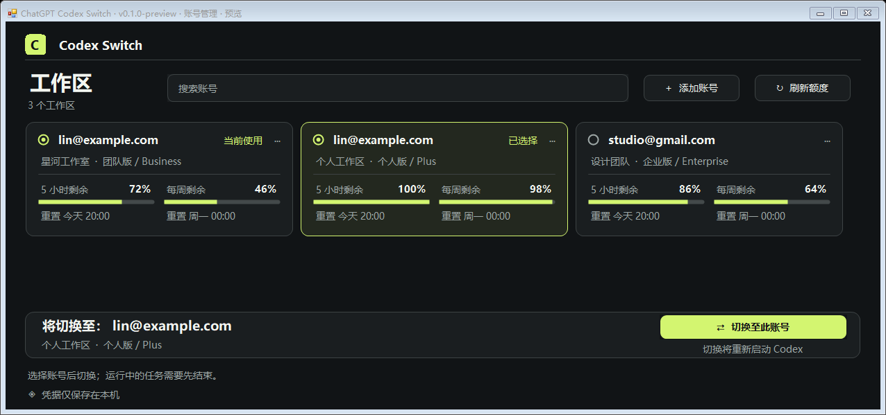

# ChatGPT Codex Switch

**Windows 上的 Codex 桌面端多账号切换与额度查看工具。**

Windows account switcher for ChatGPT-powered Codex Desktop: personal / Business / Enterprise workspaces, quota monitoring, encrypted local profiles, and switch with restart.

[English](README.en.md) · [下载 Windows 版](https://github.com/Gerson369/chatgpt-codex-switch/releases/tag/v0.1.0) · [版本记录](CHANGELOG.md)



> **v0.1.0 公开预览版。** 独立社区工具，与 OpenAI 无隶属或官方支持关系。用于 Codex 桌面端登录切换；不管理或迁移 ChatGPT 网页聊天记录。

## 解决什么问题

一个邮箱可能同时加入个人与团队工作区，多个账号也可能加入同一团队。仅列出邮箱很难分辨实际使用哪个身份。本工具分别显示邮箱、套餐、工作区与备注，并提供手动切换和额度查询。

**切换需要重新启动 Codex。** 它不是免重启热切换工具，也不会自动轮换账号或在切换后自动继续任务。

## 功能

- **多账号与工作区**：区分个人 Plus / Pro、Business 团队和 Enterprise 企业等服务返回的套餐；同邮箱的不同工作区独立保存。
- **官方登录**：调用电脑上 Codex 自带的登录程序，支持浏览器与设备码登录。设备码登录需账号或组织允许。
- **额度查看**：通过 Codex app-server 读取各账号实际返回的额度窗口，显示剩余比例与本地重置时间。没有五小时窗口时不会虚构一个；查询失败、登录过期和未返回数据分开处理。
- **三列卡片**：宽窗口并排显示三个账号；变窄时自动变为两列或一列，支持搜索、方向键和滚动。
- **备注**：右键、卡片三点或 Shift+F10 修改本机备注。
- **手动切换并重启**：先备份当前登录，再写入所选账号，并重新打开 Codex。保留原来的本地聊天、项目与配置文件。
- **确认与恢复**：切换后核实实际账号，再点击“确认切换成功”清除本次恢复备份；如有异常，可以恢复切换前账号。当前版本需要处理待确认状态后才能再次切换。
- **本机加密**：使用 Windows 当前用户的 DPAPI 加密账号备份，目录限制为当前用户访问。

## 下载与运行

1. 在 [Releases](https://github.com/Gerson369/chatgpt-codex-switch/releases) 下载 `chatgpt-codex-switch-v0.1.0-windows-x64.zip`。
2. 解压并运行 `ChatGPTCodexSwitch.exe`。这是便携版，无需安装或管理员权限。
3. 首次运行时，程序会自动保存当前有效的 Codex 文件登录。已有本工具旧版本的账号存储会继续沿用。
4. 使用“添加账号”完成其他账号的官方登录，再选择卡片，点击底部切换按钮。
5. **先保存工作并结束正在运行的任务。** 切换会结束已识别的 Codex 桌面与对应安装目录中的命令行／后台进程，再重新打开。浏览器不在结束范围内。
6. 在 Codex 中核实目标账号，然后确认本次切换成功；如异常，使用恢复入口。

关闭旧切号工具后再打开新版本。发布包附 SHA-256 校验文件。当前构建未做 Authenticode 代码签名；不要绕过系统安全阻止，可先核实来源或自行构建。

## 环境与限制

| 项目 | 支持情况 |
| --- | --- |
| 操作系统 | Windows 10 / 11 x64，建议使用系统自带的 .NET Framework 4.8 |
| Codex | Microsoft Store 包 `OpenAI.Codex`；整合版桌面程序可能显示为 ChatGPT |
| 认证 | ChatGPT 文件登录 `auth.json` |
| API Key / 系统凭据库 | 当前不支持；不会替你更改认证配置 |
| macOS / Linux / 免重启切换 | 当前不支持 |
| ChatGPT 网页聊天与云端工作区 | 不迁移；数据和权限仍属于原账号 |

额度取决于服务返回的数据，不同套餐的窗口可能不同。读取额度使用短期访问令牌，不传入刷新令牌，也不替账号续期。短期令牌过期时，可能需要重新添加账号，即使该账号仍可在 Codex 中正常续期使用。

额度使用的外部令牌 app-server 接口属于实验性能力；未来 Codex 版本可能需要适配。Business 返回的具体套餐名也可能随服务更新。

## 本地数据

- 账号加密备份：`%LOCALAPPDATA%\CodexLocalSwitcher\accounts`。
- Codex 原目录：默认 `%USERPROFILE%\.codex`；设置 `CODEX_HOME` 时使用指定目录。
- 启动和切换保留原聊天数据库、项目、技能和配置。不同账号在 Codex 侧边栏中的显示及云端可见性仍由 Codex 决定。
- 登录使用独立、仅当前用户可访问的临时目录；正常完成或取消后清理。异常断电可能留下临时文件，请勿分享整个数据目录。
- 额度查询使用独立临时目录。后台缓存下载暂时占用文件时可能留下无保存凭据的缓存目录。
- DPAPI 备份绑定当前 Windows 用户，不作为跨电脑迁移格式。

**不要上传、分享或贴出 `auth.json`、访问令牌、刷新令牌或账号加密备份。** 详见 [SECURITY.md](SECURITY.md)。

## 从源码构建

在 Windows 上运行根目录的 `build.cmd`。使用系统 .NET Framework 编译器，无 NuGet / npm 依赖。

```bat
build.cmd
```

程序输出到 `dist\ChatGPTCodexSwitch.exe`。构建同时运行模拟凭据检查与界面检查，不读取真实账号，不登录，不结束实际 Codex。

当前验证包括：34 项模拟检查、UTF-8 / 中文 Windows 编码回归、43 账号的搜索与滚动、三／两／一列布局、键盘选择、无结果保护和备注／登录方式窗口。两个 Business 与一个 Plus 账号的实际额度只读查询也已验证。并未对所有 Codex 版本、DPI 或组织策略完成覆盖；不宣称完整自动换号流程已在所有环境验证。

## 许可证与参考

[MIT](LICENSE)。仅对你有权使用的账号操作，仍需遵守相关账号、订阅与组织规则。

参考：[Codex 官方认证文档](https://learn.chatgpt.com/docs/auth)、[app-server 文档](https://learn.chatgpt.com/docs/app-server)、[社区切号与重启流程](https://github.com/karthiknl0/codex-account-switcher)。未复制该社区项目代码。
